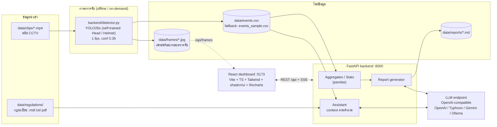
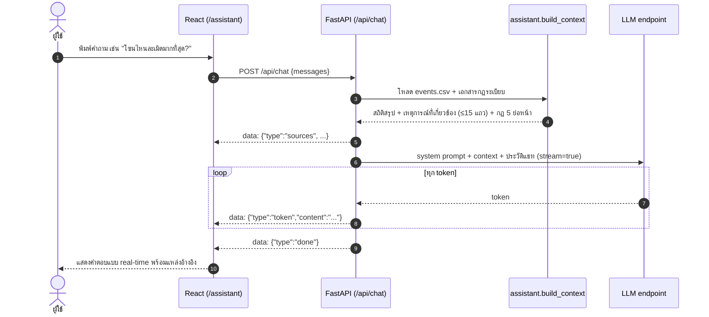

# Helmet Safety Assistant

**ระบบผู้ช่วย AI เฝ้าระวังความปลอดภัยในไซต์งานก่อสร้าง** ตรวจจับการไม่สวมหมวกนิรภัยจากคลิปกล้องวงจรปิด (CCTV) ด้วยโมเดล YOLO26s ที่ฝึกเอง, เก็บเป็นบันทึกเหตุการณ์, ให้ผู้ช่วย LLM ตอบคำถามเกี่ยวกับข้อมูลและกฎระเบียบเป็นภาษาไทย และสร้างรายงานรายวัน/รายสัปดาห์อัตโนมัติ ผ่านแดชบอร์ดเว็บภาษาไทย

> [!NOTE]
> โปรเจกต์นี้เป็น **ต้นแบบสำหรับการสาธิต (demo)** ไม่ใช่ระบบที่พร้อมใช้งานจริงในไซต์ก่อสร้าง ดูหัวข้อ [ข้อจำกัดที่ทราบ](#ข้อจำกัดที่ทราบ)

---

## สารบัญ

- [ภาพรวมและความสามารถ](#ภาพรวมและความสามารถ)
- [สถาปัตยกรรม](#สถาปัตยกรรม)
- [โครงสร้างโปรเจกต์](#โครงสร้างโปรเจกต์)
- [เริ่มต้นใช้งานด้วย Docker](#เริ่มต้นใช้งานด้วย-docker)
- [รันแบบไม่ใช้ Docker](#รันแบบไม่ใช้-docker)
- [ตั้งค่า LLM](#ตั้งค่า-llm)
- [เตรียมคลิปวิดีโอ](#เตรียมคลิปวิดีโอ)
- [รันการตรวจจับ](#รันการตรวจจับ)
- [ข้อมูลตัวอย่าง (Sample data)](#ข้อมูลตัวอย่าง-sample-data)
- [คู่มือการใช้งานแต่ละหน้า](#คู่มือการใช้งานแต่ละหน้า)
- [การประเมินผล (Evaluation)](#การประเมินผล-evaluation)
- [สรุป API](#สรุป-api)
- [การทดสอบ](#การทดสอบ)
- [ข้อจำกัดที่ทราบ](#ข้อจำกัดที่ทราบ)
- [แนวทางพัฒนาต่อ](#แนวทางพัฒนาต่อ)

---

## ภาพรวมและความสามารถ

- **ตรวจจับหมวกนิรภัยจากคลิป CCTV**: ใช้โมเดล **Ultralytics YOLO26s ที่ฝึกเอง** (50 epochs) ไฟล์ `backend/models/best.pt` มี **2 คลาส: `Head` (ศีรษะที่ไม่สวมหมวก) และ `Helmet` (สวมหมวกนิรภัย)** สุ่มเฟรมที่ 1 fps, confidence threshold 0.35
- **บันทึกเหตุการณ์ (Event log)**: หนึ่งแถวต่อหนึ่งคลิปใน `data/events.csv` พร้อมภาพเฟรมที่วาดกรอบตรวจจับแล้วใน `data/frames/`
- **แดชบอร์ดภาษาไทย**: KPI, แนวโน้มรายวัน, การละเมิดแยกตามโซน/ชั่วโมง/กล้อง, ตารางเหตุการณ์พร้อมภาพ
- **ผู้ช่วย AI (Assistant)**: ถาม-ตอบภาษาไทยเกี่ยวกับบันทึกเหตุการณ์และกฎระเบียบ ตอบแบบ streaming (SSE) อ้างอิงเอกสารด้วยชื่อไฟล์
- **รายงานอัตโนมัติ**: รายงานรายวัน/รายสัปดาห์ภาษาไทย (Markdown) ตัวเลขคำนวณด้วย pandas และ LLM เขียนส่วนบทวิเคราะห์
- **ใช้ LLM ได้หลายเจ้า**: endpoint ใดก็ได้ที่เข้ากันได้กับ OpenAI API เช่น OpenAI, Typhoon, Gemini, Ollama (รันในเครื่อง)
- **ชุดประเมินผลอัตโนมัติ**: สร้างคำถามข้อเท็จจริงจากข้อมูลพร้อมเฉลยจาก pandas แล้ววัดความแม่นยำของผู้ช่วย (มีโหมด mock เมื่อไม่มี API key)
- **ใช้งานได้ทันทีแม้ไม่มีคลิป**: มีข้อมูลตัวอย่าง 60 เหตุการณ์ (`data/events_sample.csv`) ให้ทดลองทุกหน้า

---

## สถาปัตยกรรม



### ลำดับการทำงานของแชท (Chat data flow)



**หลักการสำคัญ:** ไม่ใช้ vector database และไม่ใช้ embeddings — ระบบเลือกข้อมูลที่เกี่ยวกับคำถามด้วย pandas และการให้คะแนนคำ (`backend/retrieval.py`) เพื่อให้บริบทแต่ละคำขอมีขนาด **ไม่เกินประมาณ 2,500 tokens** (ประมาณจากความยาวข้อความ ÷ 3.5) ซึ่งจำเป็นสำหรับ LLM ฟรีที่จำกัด tokens ต่อนาที (เช่น Groq)

1. **สถิติสรุป (ส่งเสมอ)** — คำนวณด้วย pandas จากบันทึกทั้งหมด: ยอดรวม, อัตราการฝ่าฝืน, top-3 โซน/ช่วงเวลา, และรายวัน/รายโซน/รายกล้อง/รายชั่วโมง ในรูปบรรทัดสั้นที่มีป้ายกำกับ — ผู้ช่วยถูกสั่งให้ใช้ตัวเลขชุดนี้ตอบคำถามเชิงนับเท่านั้น
2. **เหตุการณ์ที่เกี่ยวข้อง (≤ 15 แถว)** — แยกวันที่ (ISO หรือแบบไทย เช่น "27 ก.ย."), โซน (รหัสหรือชื่อไทย), กล้อง, รหัสเหตุการณ์ และคำว่า "ละเมิด/ไม่สวมหมวก" จากคำถามและคำถาม 2 ข้อก่อนหน้า แล้วกรอง log ด้วย pandas ถ้าไม่พบเงื่อนไขจะส่งการฝ่าฝืนล่าสุด 10 รายการ แต่ละแถวเป็นบรรทัดที่มีป้ายกำกับ เช่น
   `EVT-0002 | วันที่ 2026-09-16 | เวลา 13:25 | กล้อง cam2 | โซน crane (โซนเครน) | สวมหมวก 0 | ไม่สวมหมวก 3 | ฝ่าฝืน: ใช่`
   และผู้ช่วยต้องคัดลอกวันที่/เวลา/กล้อง/โซนจากบรรทัดนั้นตรงตัว
3. **กฎระเบียบ 5 ย่อหน้าที่เกี่ยวข้องที่สุด** — แบ่งเอกสารใน `data/regulations/` เป็นย่อหน้า (ตารางอยู่ติดกับข้อที่เป็นเจ้าของ) จัดอันดับด้วย TF-IDF บน character trigram (ใช้ได้กับภาษาไทยที่ไม่มีเว้นวรรค) แต่ละย่อหน้ามีชื่อไฟล์และชื่อข้อกำกับเพื่อใช้อ้างอิง

แผง "แหล่งข้อมูลในบริบท" ในหน้าผู้ช่วยแสดงจำนวนแถว, เงื่อนไขที่ใช้กรอง, ย่อหน้ากฎที่ส่ง และขนาดบริบทโดยประมาณของแต่ละคำถาม

---

## โครงสร้างโปรเจกต์

```
helmet-safety-assistant/
├── backend/                  # FastAPI (Python 3.11)
│   ├── main.py               # จุดเริ่ม API (uvicorn backend.main:app)
│   ├── config.py             # อ่าน .env / ค่าตั้งต้น
│   ├── models/best.pt        # weights ของโมเดล YOLO26s ที่ฝึกเอง (ไม่ commit)
│   ├── detector.py           # YOLO26s → events.csv (python -m backend.detector)
│   ├── frame_utils.py        # แยกชื่อไฟล์คลิป, วาดกรอบบนเฟรม
│   ├── assistant.py          # สร้าง context + system prompt ของผู้ช่วย
│   ├── llm.py                # client สำหรับ endpoint ที่เข้ากันได้กับ OpenAI
│   ├── report.py             # รายงานรายวัน/รายสัปดาห์
│   ├── evaluate.py           # ชุดประเมินผล (python -m backend.evaluate)
│   ├── models.py             # pydantic models ตาม CONTRACT.md
│   ├── tests/                # pytest
│   ├── requirements.txt
│   └── Dockerfile
├── frontend/                 # React + Vite + TypeScript + Tailwind + shadcn/ui
│   └── src/{pages,components,api,hooks,lib}
├── data/
│   ├── clips/                # วางคลิป .mp4/.mov/.avi/.mkv ที่นี่
│   ├── frames/               # เฟรมที่วาดกรอบแล้ว (+ ภาพตัวอย่าง sample_*.jpg)
│   ├── regulations/          # เอกสารกฎระเบียบสำหรับผู้ช่วย AI
│   ├── reports/              # รายงานที่สร้างแล้ว
│   ├── events_sample.csv     # ข้อมูลตัวอย่าง 60 เหตุการณ์
│   └── events.csv            # (สร้างโดย detector)
├── CONTRACT.md               # สัญญา API/ข้อมูล (single source of truth)
├── docker-compose.yml
├── Makefile
└── .env.example
```

---

## เริ่มต้นใช้งานด้วย Docker

ต้องมี [Docker](https://docs.docker.com/get-docker/) และ Docker Compose v2

```bash
cp .env.example .env          # แล้วแก้ไข LLM_API_KEY / LLM_BASE_URL / LLM_MODEL
docker compose up --build     # หรือ: make up
```

| บริการ | URL |
|---|---|
| แดชบอร์ด (Frontend) | http://localhost:5173 |
| API | http://localhost:8000 |
| API docs (Swagger / OpenAPI) | http://localhost:8000/docs |

- โฟลเดอร์ `./data` ถูก mount เข้า container จึงวางคลิป/เอกสารจากเครื่องได้โดยตรง
- image ของ backend รวมไฟล์ `backend/models/best.pt` (โมเดล YOLO26s ที่ฝึกเอง) ไว้แล้ว — ต้องวางไฟล์นี้ก่อน `docker compose build` ถ้าไม่มีไฟล์ ระบบจะดาวน์โหลดโมเดลสำรองจาก Hugging Face แทน (cache ใน volume `hf-cache`)
- หยุดระบบด้วย `docker compose down` (หรือ `make down`)

> ถ้าไม่ได้ใส่ `LLM_API_KEY` ระบบยังเปิดได้ตามปกติ แดชบอร์ดและตารางเหตุการณ์ใช้งานได้ แต่หน้า "ผู้ช่วย AI" และ "รายงาน" จะแจ้งว่ายังไม่ได้ตั้งค่า LLM

---

## รันแบบไม่ใช้ Docker

ต้องมี **Python 3.11** และ **Node.js 20+**

```bash
# 1) Backend
python3.11 -m venv .venv
source .venv/bin/activate
pip install -r backend/requirements.txt
cp .env.example .env                    # ใส่ค่า LLM
uvicorn backend.main:app --reload       # รันจาก root ของ repo → http://localhost:8000

# 2) Frontend (อีกหน้าต่าง terminal)
cd frontend
npm install
npm run dev                             # → http://localhost:5173 (proxy /api → :8000)
```

### คำสั่งลัดด้วย Makefile

| คำสั่ง | ความหมาย |
|---|---|
| `make` / `make help` | แสดงรายการคำสั่งทั้งหมด |
| `make install` | สร้าง `.venv` + `pip install` + `npm install` |
| `make dev` | รัน backend และ frontend พร้อมกัน (Ctrl+C หยุดทั้งคู่) |
| `make backend` / `make frontend` | รันทีละส่วน |
| `make detect` | ประมวลผลคลิปใน `data/clips/` → `data/events.csv` |
| `make eval` / `make eval-mock` | ประเมินผู้ช่วย AI (LLM จริง / mock) |
| `make test` | รัน pytest ของ backend |
| `make build` | build frontend สำหรับ production |
| `make up` / `make down` | เปิด/ปิดระบบด้วย Docker Compose |
| `make clean` | ลบ cache และไฟล์ build (ไม่แตะข้อมูลใน `data/`) |

ใช้ Python ตัวอื่นได้ด้วยตัวแปร `PY` เช่น `make test PY=python`

---

## ตั้งค่า LLM

ระบบใช้แพ็กเกจ `openai` ต่อกับ **endpoint ใดก็ได้ที่เข้ากันได้กับ OpenAI Chat Completions API** โดยตั้งค่าผ่านตัวแปร 3 ตัวในไฟล์ `.env`

| ผู้ให้บริการ | `LLM_BASE_URL` | ตัวอย่าง `LLM_MODEL` | `LLM_API_KEY` |
|---|---|---|---|
| **OpenAI** | `https://api.openai.com/v1` | `gpt-4o-mini` | คีย์จาก platform.openai.com |
| **Typhoon** (SCB 10X, เก่งภาษาไทย) | `https://api.opentyphoon.ai/v1` | `typhoon-v2.1-12b-instruct` | คีย์จาก opentyphoon.ai |
| **Google Gemini** | `https://generativelanguage.googleapis.com/v1beta/openai/` | `gemini-3.8-flash` | คีย์จาก Google AI Studio |
| **Ollama** (รันในเครื่อง) | `http://localhost:11434/v1`<br/>(ใน Docker: `http://host.docker.internal:11434/v1`) | `qwen2.5:7b` | ใส่อะไรก็ได้ที่ไม่ว่าง เช่น `ollama` |

### การรับมือ rate limit และผู้ให้บริการสำรอง

ทุกการเรียก LLM (แชท, รายงาน, การประเมิน) ผ่าน `backend/llm.py` ซึ่งมี 3 ชั้น:

1. **Throttle ฝั่ง client** — ไม่เกิน `LLM_RPM` คำขอต่อนาทีต่อผู้ให้บริการ (ค่าเริ่มต้น `4` เพราะ Gemini free tier จำกัด 5/นาที; `0` = ไม่จำกัด) ถ้าเต็มโควตา คำขอจะรอจนมีช่องว่าง
2. **Retry + exponential backoff** — เมื่อได้ HTTP **429** หรือ **503** จะลองใหม่สูงสุด **5 ครั้ง** โดยรอ 2, 4, 8, 16 วินาที หรือรอตาม `Retry-After` ที่ server ส่งมา (รองรับ `retryDelay` ในข้อความ error ของ Gemini ด้วย) — ทุกครั้งที่ลองใหม่นับรวมใน throttle
3. **ผู้ให้บริการสำรอง (ไม่บังคับ)** — ตั้ง `LLM_FALLBACK_API_KEY`, `LLM_FALLBACK_BASE_URL`, `LLM_FALLBACK_MODEL` ครบทั้ง 3 ค่า เมื่อตัวหลักยังล้มเหลวหลังลองครบ (หรือเชื่อมต่อไม่ได้ / 5xx) ระบบจะสลับไปตัวสำรอง และข้ามตัวหลัก 60 วินาทีก่อนลองใหม่ ข้อผิดพลาดด้านการตั้งค่า (401/404) จะ **ไม่** สลับ เพื่อไม่ให้ซ่อนปัญหา log จะระบุว่าผู้ให้บริการใดเป็นผู้ตอบ

ผู้ให้บริการที่ใช้งานอยู่แสดงที่จุดสถานะ **LLM** บนแถบด้านบน (สีเหลือง + "LLM (สำรอง)" เมื่อใช้ตัวสำรอง) และใน `GET /api/health` (`llm_provider`)

> สำหรับแชท: ถ้าเริ่มส่งคำตอบไปแล้วแต่การเชื่อมต่อขาดกลางทาง จะลองใหม่ไม่ได้ (ผู้ใช้เห็นข้อความแจ้งข้อผิดพลาด) — retry/fallback ครอบคลุมเฉพาะก่อนเริ่มสตรีม

ตัวอย่าง `.env`

```dotenv
LLM_API_KEY=sk-...
LLM_BASE_URL=https://api.opentyphoon.ai/v1
LLM_MODEL=typhoon-v2.1-12b-instruct
```

ตัวแปรอื่นที่ตั้งได้

| ตัวแปร | ค่าเริ่มต้น | ความหมาย |
|---|---|---|
| `CONF_THRESHOLD` | `0.35` | ค่า confidence ขั้นต่ำของคลาส `Helmet` |
| `HEAD_CONF_THRESHOLD` | `0.55` | ค่า confidence ขั้นต่ำของคลาส `Head` (สูงกว่า เพื่อลด false violation) |
| `VIOLATION_FRAME_RATIO` | `0.4` | คลิปเป็น "การละเมิด" เมื่อพบ `Head` ≥ 1 ในอย่างน้อยสัดส่วนนี้ของเฟรมที่สุ่ม |
| `HF_MODEL_REPO` | `keremberke/yolov8n-hard-hat-detection` | repo โมเดล**สำรอง**บน Hugging Face (ใช้เฉพาะเมื่อไม่มี `backend/models/best.pt`) |
| `HF_MODEL_FILE` | `best.pt` | ชื่อไฟล์น้ำหนักของโมเดลสำรอง |
| `SITE_NAME` | `โครงการก่อสร้างอาคาร A` | ชื่อไซต์งาน (แก้ได้ในหน้า Settings) |
| `DATA_DIR` | `<repo>/data` | โฟลเดอร์ข้อมูล |

ทดสอบการเชื่อมต่อได้ที่หน้า **ตั้งค่า** (ปุ่มทดสอบ LLM → `POST /api/llm/test`) หลังแก้ `.env` ต้องรีสตาร์ต backend

> ข้อมูลบันทึกเหตุการณ์และเอกสารกฎระเบียบจะถูกส่งไปยังผู้ให้บริการ LLM ที่เลือก หากข้อมูลเป็นความลับ ให้พิจารณาใช้ Ollama ในเครื่อง

---

## เตรียมคลิปวิดีโอ

### การตั้งชื่อไฟล์

วางคลิปใน `data/clips/` (รองรับ `.mp4`, `.mov`, `.avi`, `.mkv`) และตั้งชื่อตามรูปแบบ

```
cam{ID}_{zone}_{YYYY-MM-DD}_{HHMM}.mp4
```

| ชื่อไฟล์ | กล้อง | โซน | วัน-เวลา |
|---|---|---|---|
| `cam1_entrance_2026-09-29_0815.mp4` | `cam1` | `entrance` (ทางเข้า) | 2026-09-29 08:15 |
| `cam2_crane_2026-09-29_1405.mp4` | `cam2` | `crane` (โซนเครน) | 2026-09-29 14:05 |
| `cam3_scaffold_2026-09-30_1030.mov` | `cam3` | `scaffold` (นั่งร้าน) | 2026-09-30 10:30 |
| `cam4_floor3_2026-09-30_1600.mp4` | `cam4` | `floor3` (ชั้น 3) | 2026-09-30 16:00 |
| `cam1_warehouse_2026-10-01_0930.mp4` | `cam1` | `warehouse` (คลังวัสดุ) | 2026-10-01 09:30 |

- `zone` ใช้ได้เฉพาะตัวอักษร `a-z` และตัวเลข `0-9` (ไม่สนตัวพิมพ์เล็ก/ใหญ่ ระบบแปลงเป็นตัวเล็ก) โซนใหม่ที่ไม่อยู่ในรายการข้างต้นใช้ได้ ระบบจะแสดงชื่อตามที่ตั้ง
- **Fallback:** ถ้าชื่อไฟล์ไม่ตรงรูปแบบ (หรือวัน/เวลาไม่ถูกต้อง) ระบบยังประมวลผลได้ แต่จะตั้ง `camera = "unknown"`, `zone = "unknown"` และใช้เวลาแก้ไขไฟล์ (mtime) เป็นเวลาเหตุการณ์

### แหล่งคลิปที่ใช้ได้ฟรี

หาคลิปทดสอบได้จากเว็บวิดีโอที่ให้สิทธิ์ใช้งานฟรี เช่น

- [Pexels Videos](https://www.pexels.com/videos/) ([Pexels License](https://www.pexels.com/license/))
- [Pixabay Videos](https://pixabay.com/videos/) ([Pixabay Content License](https://pixabay.com/service/license-summary/))

คำค้นที่แนะนำ: `construction worker helmet`, `construction site`, `hard hat worker`, `scaffolding worker`, `crane construction site`, `building site workers`

เคล็ดลับ: เลือกคลิปมุมสูงคล้ายกล้อง CCTV ที่เห็นศีรษะคนงานชัดเจน ความยาว 10–60 วินาที และตัดให้สั้นลงได้ด้วย `ffmpeg -i in.mp4 -t 30 -c copy out.mp4`

### บันทึกสัญญาอนุญาต (License record)

> [!IMPORTANT]
> ผู้ใช้ **ต้องบันทึกแหล่งที่มาและสัญญาอนุญาตของทุกคลิป** ที่นำมาใช้ และตรวจสอบเงื่อนไขของสัญญาอนุญาตเอง (แม้จะเป็นคลิปฟรี) ห้ามใช้คลิปที่มีบุคคลระบุตัวตนได้ในทางที่อาจก่อความเสียหายแก่บุคคลนั้น
> คลิป CCTV จริงจากไซต์งานต้องได้รับอนุญาตจากเจ้าของโครงการ และปฏิบัติตาม พ.ร.บ. คุ้มครองข้อมูลส่วนบุคคล (PDPA)

คัดลอกตารางนี้แล้วกรอกข้อมูลของคลิปที่ใช้

| ไฟล์ | แหล่งที่มา (URL) | ผู้สร้าง | สัญญาอนุญาต | วันที่ดาวน์โหลด |
|---|---|---|---|---|
| `cam1_entrance_2026-09-29_0815.mp4` | https://www.pexels.com/video/... | _ชื่อผู้สร้าง_ | Pexels License | YYYY-MM-DD |
| `cam2_crane_2026-09-29_1405.mp4` | https://pixabay.com/videos/... | _ชื่อผู้สร้าง_ | Pixabay Content License | YYYY-MM-DD |
| | | | | |

---

## รันการตรวจจับ

มี 2 วิธี

**1) Command line**

```bash
python -m backend.detector                      # หรือ: make detect
python -m backend.detector --clips path/to/clips --conf 0.4 --head-conf 0.6 --vote-ratio 0.5 --out data/events.csv
python -m backend.detector --compare --clips path/to/clips   # เทียบ YOLO26s กับโมเดล HF → data/model_comparison.csv
```

`--compare` รันโมเดล YOLO26s ที่ฝึกเองและโมเดล yolov8n จาก Hugging Face กับคลิปชุดเดียวกัน (threshold และเกณฑ์โหวตเดียวกัน) แล้วพิมพ์ตารางเทียบรายคลิป: จำนวน helmet, จำนวน head/no-hardhat, ธงการละเมิด, confidence เฉลี่ย และความเร็ว (FPS เฉพาะเวลาที่โมเดลประมวลผล) พร้อมบันทึก `data/model_comparison.csv` — โหมดนี้ **ไม่** แก้ `events.csv` และไม่เขียนทับ `backend/models/best.pt`

**โมเดลและไฟล์ weights:** detector ใช้โมเดล **YOLO26s ที่ฝึกเอง** ที่ `backend/models/best.pt` เสมอเมื่อมีไฟล์นี้ (จะไม่ติดต่อ Hugging Face เลย) โมเดลมี 2 คลาส และ map เป็นคอลัมน์ใน `events.csv` ผ่าน `CLASS_MAP` ใน `backend/detector.py` โดยอ่านชื่อคลาสจาก `model.names` ตอนรัน:

| คลาสของโมเดล | นับเป็น |
|---|---|
| `Helmet` | `hardhat` (สวมหมวก) |
| `Head` | `no_hardhat` (ไม่สวมหมวก → ละเมิด) |

*ทางสำรอง (fallback):* ถ้าไม่มี `backend/models/best.pt` ระบบจะดาวน์โหลดโมเดล YOLOv8n จาก Hugging Face (`HF_MODEL_REPO` / `HF_MODEL_FILE`, คลาส `Hardhat` / `NO-Hardhat` ซึ่ง `CLASS_MAP` รองรับอยู่แล้ว) แล้วคัดลอกไปไว้ที่ `backend/models/best.pt` — ไฟล์ `.pt` ไม่ถูก commit (ดู `.gitignore`) ตรวจสอบโมเดลที่ใช้อยู่ได้ที่ `GET /api/detect/model-info` หรือหน้า **ตั้งค่า**

**2) ผ่านหน้าเว็บ**: ไปที่หน้า **ตั้งค่า (`/settings`)** อัปโหลดคลิป (หรือวางไฟล์ใน `data/clips/` เอง) แล้วกดปุ่มประมวลผล ระบบจะแสดงความคืบหน้าทีละคลิป (`POST /api/detect/run`, `GET /api/detect/status`)

ขั้นตอนที่ detector ทำกับแต่ละคลิป

1. โหลดโมเดล YOLO26s จาก `backend/models/best.pt` (ครั้งแรกครั้งเดียว)
2. สุ่มเฟรมที่ **1 fps** แล้วรันโมเดล โดยใช้ threshold แยกตามคลาส: `Helmet` ≥ `CONF_THRESHOLD` (0.35), `Head` ≥ `HEAD_CONF_THRESHOLD` (0.55)
3. นับ `Helmet` (→ `hardhat`) / `Head` (→ `no_hardhat`) ต่อเฟรม แล้วเก็บ **ค่าสูงสุด** ของทั้งคลิป
4. **โหวตตามเวลา (temporal voting):** คลิปจะเป็นการละเมิดก็ต่อเมื่อพบ `Head` ≥ 1 ใน **อย่างน้อย 40%** ของเฟรมที่สุ่ม (`VIOLATION_FRAME_RATIO`) — การตรวจพบ `Head` แบบวูบวาบไม่กี่เฟรม (มักเกิดจากการบีบอัดวิดีโอ) จะไม่ถูกนับ
5. บันทึกเฟรมตัวแทน (เฟรมที่มี `Head` มากที่สุด) พร้อมวาดกรอบลง `data/frames/`
6. เขียน `data/events.csv` ใหม่ทั้งไฟล์ (สแกนทุกคลิปใหม่ทุกครั้ง) ถ้าไม่มีคลิปเลย ระบบจะ **ไม่** สร้างหรือเขียนทับไฟล์

### คอลัมน์ใน `events.csv`

หนึ่งแถวต่อหนึ่งคลิป

| คอลัมน์ | ชนิด | คำอธิบาย |
|---|---|---|
| `event_id` | str | รหัสเหตุการณ์ `EVT-0001`… เรียงตามเวลา |
| `datetime` | str | วันเวลา ISO `YYYY-MM-DDTHH:MM:SS` (เวลาท้องถิ่น) |
| `date` | str | `YYYY-MM-DD` |
| `time` | str | `HH:MM` |
| `camera` | str | เช่น `cam2` หรือ `unknown` |
| `zone` | str | โซน (ตัวพิมพ์เล็ก) |
| `clip` | str | ชื่อไฟล์คลิป |
| `hardhat` | int | จำนวนคนสวมหมวกสูงสุดในเฟรมใดเฟรมหนึ่ง |
| `no_hardhat` | int | จำนวนคนไม่สวมหมวกสูงสุดในเฟรมใดเฟรมหนึ่ง — **เป็น 0 ถ้าไม่ผ่านการโหวต** (สอดคล้องกับ `violation`) |
| `total_person` | int | จำนวนคนรวมสูงสุดในเฟรมเดียวกัน |
| `violation` | bool | `true` ถ้าพบ `Head` ใน ≥ `VIOLATION_FRAME_RATIO` ของเฟรม (เท่ากับ `no_hardhat > 0`) |
| `max_conf` | float | confidence สูงสุดของการตรวจจับในคลิป (0 ถ้าไม่พบ) |
| `frame_path` | str | ชื่อไฟล์เฟรมใน `data/frames/` (ว่างถ้าไม่มี) |
| `no_hardhat_max` | int | จำนวน `Head` สูงสุดต่อเฟรม **ก่อน** การโหวต (ดูว่าโมเดลเห็นอะไร แม้คลิปจะไม่ถูกนับเป็นการละเมิด) |
| `no_hardhat_ratio` | float | สัดส่วนเฟรมที่พบ `Head` ≥ 1 (0–1) |

log เก่าที่ไม่มีสองคอลัมน์สุดท้าย (เช่น `events_sample.csv`) ยังอ่านได้ตามปกติ: `no_hardhat_max` = `no_hardhat` และ `no_hardhat_ratio` = ว่าง

---

## ข้อมูลตัวอย่าง (Sample data)

ถ้ายังไม่มี `data/events.csv` ระบบจะใช้ **`data/events_sample.csv`** (60 เหตุการณ์สมมติ ระหว่าง 2026-09-16 ถึง 2026-09-29, 4 กล้อง, 5 โซน) อัตโนมัติ

- ภาพประกอบของข้อมูลตัวอย่างคือไฟล์ `data/frames/sample_*.jpg` ซึ่งเป็น **ภาพวาดจำลอง** (มีลายน้ำ "SAMPLE / ภาพตัวอย่าง") ไม่ใช่ผลตรวจจับจริง
- ตรวจสอบได้ว่ากำลังใช้ข้อมูลชุดใดจากค่า `data_source` (`"sample"` หรือ `"real"`) ใน `GET /api/health`
- เมื่อรัน detector กับคลิปจริงสำเร็จ ระบบจะสลับไปใช้ `events.csv` ทันที หากต้องการกลับไปใช้ข้อมูลตัวอย่าง ให้ลบหรือเปลี่ยนชื่อ `data/events.csv`

---

## คู่มือการใช้งานแต่ละหน้า

| หน้า | การใช้งาน |
|---|---|
| **แดชบอร์ด** `/dashboard` | ภาพรวม: การ์ด KPI (เหตุการณ์ทั้งหมด, การละเมิด, อัตราการละเมิด, โซนที่ละเมิดมากที่สุด) พร้อมแนวโน้มเทียบช่วงก่อนหน้า, กราฟรายวัน, กราฟแยกโซน/ชั่วโมง/กล้อง และเหตุการณ์ละเมิดล่าสุด เลือกช่วงวันที่ได้ (ค่าเริ่มต้น 7 วันล่าสุดของข้อมูล) และมีป้ายบอกว่าใช้ข้อมูลจริงหรือข้อมูลตัวอย่าง |
| **เหตุการณ์** `/events` | ตารางบันทึกเหตุการณ์ กรองตามวันที่ โซน กล้อง และสถานะละเมิด เรียงลำดับและแบ่งหน้าได้ คลิกแถวเพื่อดูภาพเฟรมที่มีกรอบตรวจจับ |
| **ผู้ช่วย AI** `/assistant` | แชทถามตอบภาษาไทย เช่น "สัปดาห์นี้โซนไหนละเมิดมากที่สุด", "ช่วงเวลาไหนเสี่ยงที่สุด", "กฎกำหนดเรื่องสายรัดคางไว้อย่างไร" มีคำถามแนะนำ 5 ข้อ และแสดงแหล่งข้อมูลที่ใช้ตอบ (ช่วงวันที่ของ log, เอกสารกฎระเบียบ) |
| **รายงาน** `/reports` | สร้างรายงานรายวัน (เลือกวัน) หรือรายสัปดาห์ (เลือกวันเริ่ม, 7 วัน) ประกอบด้วยบทสรุปผู้บริหาร, การละเมิดแยกโซน/ช่วงเวลา, เหตุการณ์สำคัญพร้อมภาพ, การประเมินความเสี่ยง และข้อเสนอแนะ ดูรายงานเก่าย้อนหลังได้ |
| **โซน** `/zones` | สรุปแต่ละโซน: จำนวนเหตุการณ์ การละเมิด อัตราการละเมิด และ sparkline การละเมิด 14 วันล่าสุด |
| **ตั้งค่า** `/settings` | ตั้งชื่อไซต์งาน, ดูสถานะการตั้งค่า LLM และทดสอบการเชื่อมต่อ, อัปโหลดคลิปและสั่งรันการตรวจจับ, จัดการเอกสารกฎระเบียบ (อัปโหลด/ลบ) |

---

## การประเมินผล (Evaluation)

```bash
python -m backend.evaluate            # หรือ: make eval       (ใช้ LLM จริงถ้ามี LLM_API_KEY)
python -m backend.evaluate --mock     # หรือ: make eval-mock  (ไม่ต้องใช้ API key)
```

วิธีการ

1. สร้าง **คำถามข้อเท็จจริงประมาณ 15 ข้อ** จากข้อมูลอัตโนมัติ เช่น จำนวนการละเมิดทั้งหมด, โซนที่ละเมิดมากที่สุด, จำนวนการละเมิดของวันที่กำหนด, ชั่วโมงที่เสี่ยงที่สุด
2. คำนวณ **เฉลย (ground truth)** ด้วย pandas
3. ส่งคำถามให้ผู้ช่วยตอบด้วย context เดียวกับที่ใช้ในแชท
4. ตรวจว่า **ตัวเลขหรือชื่อ (label) ที่คาดหวังปรากฏอยู่ในคำตอบ** หรือไม่ (exact-match แบบหลวม)
5. ถามทีละข้อตามลำดับ ภายใต้ throttle/retry/fallback เดียวกับแชท แล้วแสดง **accuracy**, เวลาที่ใช้ทั้งหมด และจำนวนครั้งที่ลองใหม่ บันทึกรายละเอียดแต่ละข้อลง `data/eval_results.csv` (คอลัมน์: `question`, `expected`, `answer`, `correct`, `provider`, `model`, `retries`, `waited_s`, `elapsed_s`) — ที่ 4 คำขอ/นาที การประเมิน 15 ข้อใช้เวลาอย่างน้อยประมาณ 3–4 นาที

**โหมด mock:** ถ้าไม่ได้ตั้ง `LLM_API_KEY` หรือใส่ `--mock` ระบบจะใช้ mock LLM ที่ตอบจาก aggregates ชุดเดียวกัน เพื่อให้ pipeline ทำงานได้ครบตั้งแต่ต้นจนจบ (ผลในโหมดนี้ใช้ตรวจว่าระบบทำงาน ไม่ได้วัดคุณภาพของ LLM จริง)

> ข้อจำกัด: การตรวจแบบ "มีคำตอบที่คาดหวังอยู่ในข้อความ" อาจนับถูกเกินจริง (เช่น คำตอบที่ระบุหลายตัวเลข) หรือนับผิดเมื่อ LLM เขียนตัวเลขเป็นคำ ควรอ่านคำตอบใน `eval_results.csv` ประกอบ

---

## สรุป API

Base prefix `/api` ทุก endpoint ตอบเป็น JSON (ยกเว้นภาพเฟรมและแชทแบบ SSE) รายละเอียดเต็มดูที่ http://localhost:8000/docs และ [`CONTRACT.md`](CONTRACT.md)

| Method | Path | คำอธิบาย |
|---|---|---|
| GET | `/api/health` | สถานะระบบ, แหล่งข้อมูล, การตั้งค่า LLM |
| GET | `/api/stats` | KPI + แนวโน้ม (`from`, `to`, `zone`, `camera`) |
| GET | `/api/events` | รายการเหตุการณ์แบบแบ่งหน้า กรองและเรียงได้ |
| GET | `/api/events/{event_id}` | เหตุการณ์เดียว |
| GET | `/api/aggregates` | สรุปตาม `group_by` = `zone` / `camera` / `hour` / `day` |
| GET | `/api/frames/{filename}` | ภาพเฟรม JPEG |
| GET | `/api/zones` | สรุปรายโซน + sparkline 14 วัน |
| GET | `/api/cameras` | สรุปรายกล้อง |
| POST | `/api/chat` | แชทกับผู้ช่วย AI (SSE stream) |
| GET | `/api/chat/context` | แหล่งข้อมูลที่ใช้เป็น context |
| POST | `/api/chat/suggestions` | คำถามแนะนำ 5 ข้อ |
| POST | `/api/reports` | สร้างรายงาน (`daily` / `weekly`) |
| GET | `/api/reports` | รายการรายงาน |
| GET | `/api/reports/{name}` | อ่านรายงาน |
| POST | `/api/detect/run` | เริ่มประมวลผลคลิป |
| GET | `/api/detect/status` | ความคืบหน้าการประมวลผล |
| GET | `/api/detect/model-info` | ข้อมูลโมเดล: ตระกูลโมเดล (เช่น `yolo26s`), path ของ weights, แหล่งที่มา (`local` / `downloaded`), ชื่อคลาส และการ map คลาส |
| GET | `/api/clips` | รายการคลิป + ผลการแยกชื่อไฟล์ |
| POST | `/api/clips/upload` | อัปโหลดคลิป (multipart `files`) |
| GET | `/api/regulations` | รายการเอกสารกฎระเบียบ |
| POST | `/api/regulations/upload` | อัปโหลดเอกสาร `.md` / `.txt` / `.pdf` |
| DELETE | `/api/regulations/{name}` | ลบเอกสาร |
| GET / PUT | `/api/settings` | อ่าน/แก้ชื่อไซต์งาน |
| POST | `/api/llm/test` | ทดสอบการเชื่อมต่อ LLM |

ข้อผิดพลาดใช้รูปแบบเดียวกันทั้งหมด: `{"error": {"code": "...", "message": "ข้อความภาษาไทย"}}`

---

## การทดสอบ

```bash
make test                   # = .venv/bin/python -m pytest backend/tests -q
```

ชุดทดสอบอยู่ใน `backend/tests/` (เช่น การแยกชื่อไฟล์คลิปตามรูปแบบที่กำหนด) ออกแบบให้รันได้โดยไม่ต้องมี LLM API key

ฝั่ง frontend: `cd frontend && npm run build` เพื่อตรวจ type และ build

---

## ข้อจำกัดที่ทราบ

- **ความแม่นยำของโมเดล**: โมเดล YOLO26s ที่ฝึกเองอาจเกิด **false positive** และ **false negative** เมื่อภาพต่างจากชุดข้อมูลฝึก (คนอยู่ไกล ถูกบัง แสงน้อย มุมกล้องต่าง) จากการทดสอบพบว่า **การบีบอัดวิดีโอ (สีเพี้ยนเล็กน้อย) ทำให้หมวกสีอ่อนที่อยู่ไกลถูกจัดเป็น `Head`** ได้ ทั้งที่ภาพนิ่งต้นฉบับถูกจัดเป็น `Helmet` — ควรเพิ่มข้อมูลฝึกจากเฟรมวิดีโอ CCTV จริง / augmentation ด้านสีและการบีบอัด ระบบลดผลกระทบด้วย threshold ของ `Head` ที่สูงกว่า และการโหวตตามเวลา (ในชุดทดสอบ 11 คลิป false violation ลดจาก 4 เหลือ 0 โดยคลิปที่มีคนไม่สวมหมวกจริงยังถูกตรวจพบ) แต่แลกกับการที่คนไม่สวมหมวกซึ่งปรากฏสั้น ๆ (< 40% ของคลิป) อาจไม่ถูกนับ
- **หนึ่งแถวต่อหนึ่งคลิป, ไม่ติดตามบุคคล**: ใช้ค่าสูงสุดต่อเฟรม ไม่มี object tracking จึงไม่รู้ว่าเป็นคนเดิมหรือคนใหม่ และไม่รู้ระยะเวลาที่ไม่สวมหมวก
- **สุ่มเฟรม 1 fps**: เหตุการณ์ที่สั้นมาก (เช่น ถอดหมวกไม่ถึงวินาที) อาจตรวจไม่พบ
- **การเลือกบริบทแบบกฎ (ไม่ใช่ semantic search)**: ผู้ช่วยเห็นเหตุการณ์รายตัวเพียง ≤ 15 แถวที่ตรงกับวันที่/โซน/กล้อง/รหัสในคำถาม และกฎเพียง 5 ย่อหน้า — คำถามที่อ้างถึงสิ่งที่ตัวแยกคำไม่รู้จัก (เช่น "เมื่อวาน", ช่วงเวลา) จะได้การฝ่าฝืนล่าสุดแทน และกฎที่ใช้คำต่างจากคำถามมากอาจไม่ถูกดึงมา (ผู้ช่วยถูกสั่งให้แจ้งว่าไม่พบในเอกสารที่ดึงมา) ตัวเลขเชิงนับยังถูกต้องเพราะมาจากสถิติสรุปที่ส่งเสมอ
- **LLM อาจตอบผิด**: แม้จะได้ตัวเลขที่คำนวณไว้แล้ว LLM ยังอาจสรุปผิดหรือแต่งข้อมูล (hallucination) **ต้องตรวจสอบกับข้อมูลจริงก่อนนำไปใช้ตัดสินใจ**
- **เอกสารกฎระเบียบตัวอย่างไม่ใช่กฎหมายจริง**: `data/regulations/safety_rules_example.md` เขียนขึ้นเพื่อการสาธิต ต้องแทนที่ด้วยกฎกระทรวง/มาตรฐาน มอก. ฉบับจริง
- **ไม่มีระบบยืนยันตัวตน (authentication)**: ห้ามเปิดให้เข้าถึงจากอินเทอร์เน็ตโดยตรง
- **รองรับไซต์งานเดียว**: ไม่มีการแยกหลายโครงการ/หลายผู้ใช้
- **ใช้ไฟล์ในเครื่องแทนฐานข้อมูล**: CSV/Markdown/JSON เหมาะกับข้อมูลขนาดเล็ก ไม่รองรับการเขียนพร้อมกันหลายตัว
- **ประมวลผลแบบ batch จากคลิป**: ไม่ใช่การเฝ้าดูสตรีมกล้องแบบ real-time

---

## แนวทางพัฒนาต่อ

- Fine-tune โมเดลด้วยภาพจากไซต์งานจริง และเพิ่มคลาส PPE อื่น (เสื้อสะท้อนแสง, เข็มขัดนิรภัย)
- เพิ่ม object tracking (เช่น ByteTrack) เพื่อนับจำนวนคนที่ไม่ซ้ำและระยะเวลาการละเมิด
- รับสตรีม RTSP จากกล้องจริงแบบ real-time และแจ้งเตือนทันที (LINE Notify / LINE OA, อีเมล)
- เปลี่ยนจาก context stuffing เป็น RAG (vector search) และ text-to-SQL/pandas tool calling เมื่อข้อมูลมีขนาดใหญ่
- ย้ายข้อมูลไปฐานข้อมูล (PostgreSQL/SQLite) และเพิ่มระบบผู้ใช้/สิทธิ์ (auth, RBAC) รองรับหลายไซต์งาน
- ขยายชุดประเมินผล: คำถามเชิงเหตุผล, ใช้ LLM-as-judge, วัดความถูกต้องของการอ้างอิงกฎระเบียบ
- ปิดบังใบหน้าในภาพเฟรม (face blurring) เพื่อความเป็นส่วนตัวตาม PDPA
- ส่งออกรายงานเป็น PDF

---

<sub>ภาพใน `data/frames/sample_*.jpg` เป็นภาพวาดจำลองที่สร้างด้วยโปรแกรมสำหรับการสาธิตเท่านั้น</sub>
